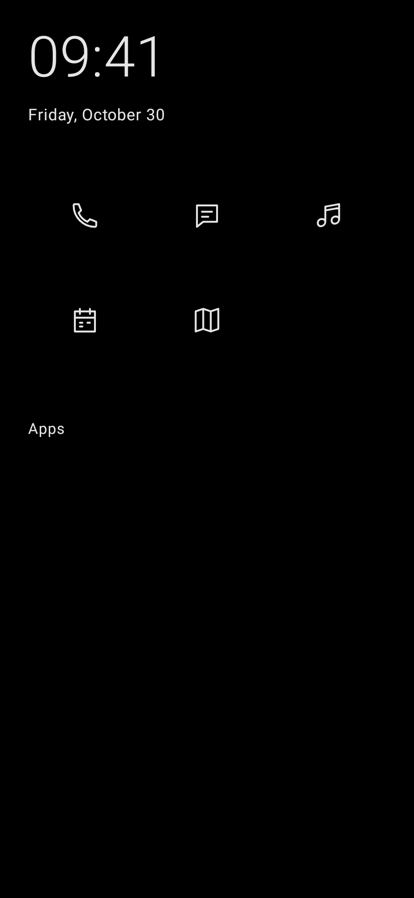
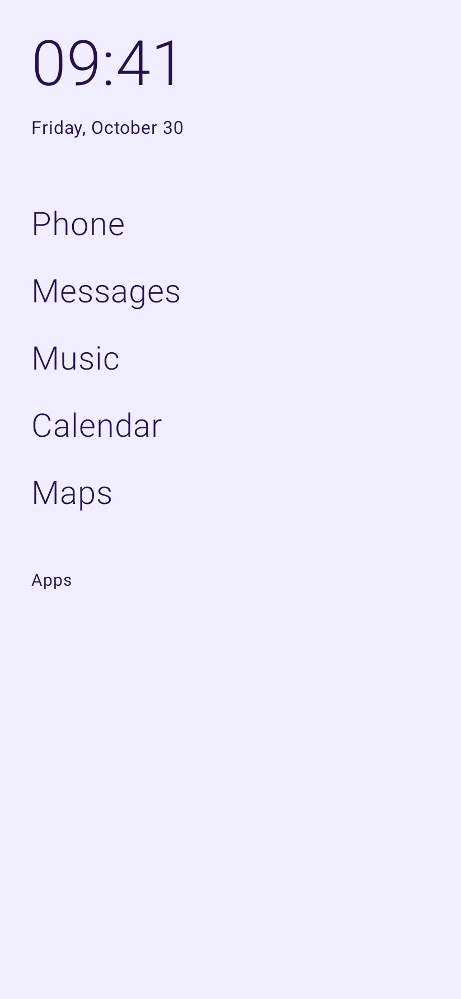
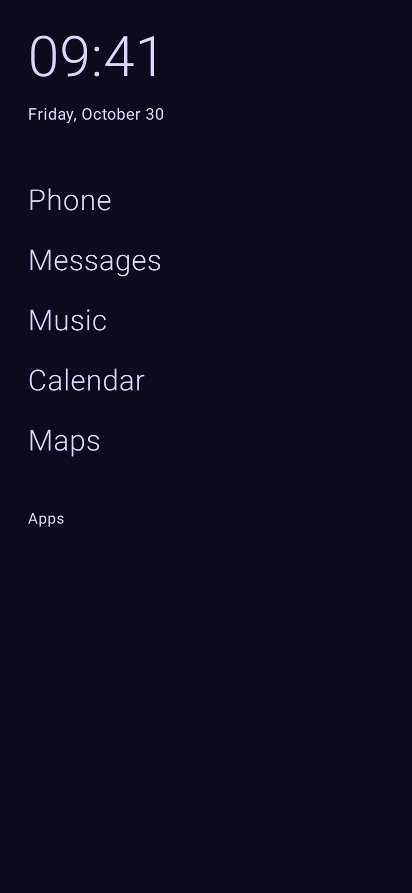

# nia

A quiet Android launcher. Five everyday shortcuts, a clock and date, and a searchable app list made of names.

nia is a native Kotlin/Jetpack Compose MVP. It can become your actual default Home app. The first acceptance device is a Pixel 10 Pro using its normal personal profile.

<p>
  
  
  
</p>

Rendered from the app's Compose screens; phone screenshots will also include the system bars.

## What works

- Fixed Phone, Messages, Music, Calendar and Maps shortcuts, each assigned to an installed app.
- Top-aligned icon grid or a text-only Home list.
- Time opens Clock; date opens your assigned Calendar.
- Swipe up or tap **Apps** for an alphabetical, text-only app list.
- Search by name, with an optional automatic keyboard/focus setting.
- First-launch setup and Android's default-launcher selection.
- Black/white or one-color themes, with **System / Light / Dark** modes.
- Select violet, rose, blue, mint, amber, coral or a custom hex color: nia generates matching pastel/dark background and foreground pairs. Both variants are previewed together. Generated pairs target at least **7:1** text contrast.
- Pure `#000000` in monochrome dark mode, plus an OLED-black option for colored dark themes.
- Persistent preferences and versioned settings export/import, including app assignments.
- Missing-app recovery, live package-list updates and a settings reset/recovery path.
- Offline operation. The app requests no network, contacts, SMS, calendar-content or notification access.

## Install an MVP build

Open **[Actions → Checks](https://github.com/robin-siegl/Nia/actions/workflows/ci.yml)**. Choose a successful run and download the **nia-debug** artifact. Extract and install the APK, open nia, assign your apps and tap **Set as default launcher**. Android's Home-app chooser must be completed to use nia when pressing Home.

Development builds have their own package ID (`dev.robinsiegl.nia.debug`) so they can coexist with production builds. Prefer production APKs for long-term use and updates.

## Production APK in a few clicks

There is one private setup step for your persistent release signing key:

```sh
python scripts/setup_signing.py --upload
```

This uses JDK 17+ (or Android Studio's bundled Java) and an authenticated [GitHub CLI](https://cli.github.com/). It creates a local key once and sets **one** repository Actions secret: `NIA_SIGNING_BUNDLE`. Re-running reuses the same key. On Windows you can use:

```powershell
.\scripts\setup-signing.ps1 --upload
```

Without GitHub CLI, run the Python script without `--upload`, then copy its generated JSON into **Settings → Secrets and variables → Actions → New repository secret → NIA_SIGNING_BUNDLE**. The script prints the local file path, not its contents.

Then open **[Actions → Production APK → Run workflow](https://github.com/robin-siegl/Nia/actions/workflows/production.yml)**. Leave the version blank to use `gradle.properties`. Download the **nia-production-VERSION** artifact after the checks and signed build pass. Optionally enable **publish_release** to attach the signed APK and checksum to a public GitHub release.

The production workflow requires signing configuration and does not substitute a debug key. Keep a private backup of `.signing/`; those files are excluded from Git. See [release instructions](docs/RELEASING.md).

## Build locally

Use JDK 17+, Android SDK Platform 36 and Build Tools 36.0.0. Install through Android Studio or `sdkmanager`, and set `ANDROID_HOME` or `sdk.dir` in `local.properties`.

```sh
./gradlew :app:assembleDebug
./gradlew :app:testDebugUnitTest
./gradlew :app:lintDebug
```

On Windows use `gradlew.bat`. The wrapper includes a pinned Gradle distribution checksum. AGP 9.1.1 supplies built-in Kotlin; Compose and serialization plugins match Kotlin 2.2.10. Dependencies are pinned, rather than resolved through dynamic version ranges.

Minimum Android is 10 (API 29); the build compiles/targets API 36. The user's Android 17 phone remains the primary physical acceptance target. A lower target API does not prevent an app from running on a newer Android version.

## Verification

The test suite covers palette contrast across RGB samples, theme mode behavior, search normalization/order, backup validation/round trips, navigation, Home shortcuts, swipe access, search focus and screen rendering. Robolectric renders the Compose UI at API 35; screenshots are included in CI's test-report artifact. Host-side UI tests cannot establish Pixel gesture/Recents behavior: use the [device acceptance checklist](docs/DEVICE_TESTING.md) before calling the MVP phone-verified.

## Scope and next steps

The MVP supports the personal profile. Work profiles and Private Space are deferred and are not advertised as supported. Home categories remain fixed. Widgets, folders and feeds are outside this design.

- [Requirements and decisions](docs/REQUIREMENTS.md)
- [Release setup](docs/RELEASING.md)
- [Device acceptance](docs/DEVICE_TESTING.md)
- [Prioritized roadmap](docs/ROADMAP.md)

The source license is still to be selected.
