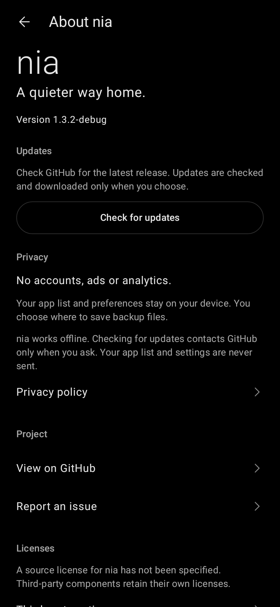

# nia

A quiet Android launcher. Five everyday shortcuts, a clock and date, and a searchable app list made of names.

nia is a native Kotlin/Jetpack Compose launcher. It can become your actual default Home app. The primary device is a Pixel 10 Pro using its normal personal profile.

<p>
  
  
  
  
</p>

<p>
  
  
  
</p>

Rendered from the app's Compose screens; phone screenshots will also include the system bars.

## What works

- Fixed Phone, Messages, Music, Calendar and Maps shortcuts, each assigned to an installed app.
- Top-aligned icon grid or a text-only Home list.
- Apps completes the six-item icon grid or appears as a matching text entry. A settings gear is available on Home and in the app list.
- Small, Default or Large Home text, with a preview in Settings.
- Time opens Clock; date opens your assigned Calendar.
- A Pixel-style clock/date layout matches the supplied Pixel 10 Pro lock-screen reference: spaced time, a stronger date and fixed screen anchors. Disable **Settings → Home → Pixel clock layout** for the previous scalable clock. In Pixel mode, text-size choices apply to Home app names.
- Swipe up or tap **Apps** for an alphabetical, text-only app list.
- Search by name, initials (including camel-case names) or word prefixes in any order. Matching apps stay alphabetical. Search can focus automatically if enabled.
- Optional alphabet navigation: drag the right edge of the app list to jump to a letter. Letters appear during interaction; searching hides the scrubber.
- Four-step first-launch setup: layout/text size, app assignments, appearance and default launcher. Progress survives app selection and reopening nia; previews show your Home before you finish.
- Focused Settings pages for Home, Appearance, App assignments, App list, Backup & reset and About nia. Android's default launcher can be changed from the Settings overview.
- About includes the app version, privacy details, GitHub/issue links and third-party notices.
- Black/white or one-color themes, with **System / Light / Dark** modes.
- Use the visual color wheel and brightness slider, a preset, or a custom hex color: nia generates matching pastel/dark background and foreground pairs. Both variants preview live; wheel/slider changes save when released, and hex input uses Apply. Generated pairs target at least **7:1** text contrast.
- Pure `#000000` in monochrome dark mode, plus an OLED-black option for colored dark themes.
- Persistent preferences and versioned settings export/import, including app assignments.
- Missing-app recovery, live package-list updates and a settings reset/recovery path.
- Offline operation. The app requests no network, contacts, SMS, calendar-content or notification access.

## Install nia

After a production build succeeds, download **nia-VERSION.apk** from **[Releases](https://github.com/robin-siegl/Nia/releases)**. Install it, open nia and follow the guided setup. Complete Android's Home-app chooser to use nia when pressing Home.

Development APKs are also available under **[Actions → Checks](https://github.com/robin-siegl/Nia/actions/workflows/ci.yml)**: choose a successful run, download the **nia-debug** artifact and extract its APK.

Development builds have their own package ID (`dev.robinsiegl.nia.debug`) so they can coexist with production builds. Prefer production APKs for long-term use and updates.

## Production APK in a few clicks

Configure the same four repository Actions secrets used by pip-os: `ANDROID_KEYSTORE_BASE64`, `ANDROID_KEYSTORE_PASSWORD`, `ANDROID_KEY_ALIAS` and `ANDROID_KEY_PASSWORD`, using your nia keystore and credentials. The [one-time signing instructions](docs/RELEASING.md#one-time-signing-setup) include the keystore command and PowerShell copy-to-clipboard step.

If those secrets are already added, setup is complete. Open **[Actions → Production APK → Run workflow](https://github.com/robin-siegl/Nia/actions/workflows/production.yml)** on `main`, leave **publish_release** enabled and select **Run workflow**. The APK, tag and release use the exact `nia.versionName` and `nia.versionCode` committed in [gradle.properties](gradle.properties), currently **1.1.1 / 1001001**. There are no version inputs or automatic bumps; the project version is updated with the changes before each new release.

Public release publication is enabled by default. The signed APK and checksum are also uploaded as the **nia-production-VERSION** artifact. Existing or older versions and mismatched Android version codes are rejected before building, and the tag is created only after tests, lint, build and signature verification succeed.

Keep a private backup of your keystore and passwords and use the same key for future updates. No additional signing-bundle secret is required. See [release instructions](docs/RELEASING.md) for the optional setup helper, local builds and troubleshooting.

## Build locally

Use JDK 17+, Android SDK Platform 36 and Build Tools 36.0.0. Install through Android Studio or `sdkmanager`, and set `ANDROID_HOME` or `sdk.dir` in `local.properties`.

```sh
./gradlew :app:assembleDebug
./gradlew :app:testDebugUnitTest
./gradlew :app:lintDebug
```

On Windows use `gradlew.bat`. The wrapper includes a pinned Gradle distribution checksum. AGP 9.1.1 supplies built-in Kotlin; Compose and serialization plugins match Kotlin 2.2.10. Dependencies are pinned, rather than resolved through dynamic version ranges.

Minimum Android is 10 (API 29); the build compiles/targets API 36. The user's Android 17 phone remains the primary physical acceptance target. A lower target API does not prevent an app from running on a newer Android version.

## Verification

The test suite covers palette contrast across RGB samples, theme behavior, smart search/order, backup compatibility, saved setup progress, navigation, guided setup, Settings pages, About links, Home gestures, keyboard focus and screen rendering. Python tests also exercise signing helpers and release version selection. Robolectric renders the Compose UI at API 35; screenshots are included in CI's test-report artifact. Use the [device acceptance checklist](docs/DEVICE_TESTING.md) for physical Pixel gestures, Recents and signed upgrades.

## Scope and next steps

nia 1.0 supports the personal profile. Work profiles and Private Space are deferred and are not advertised as supported. Home categories remain fixed. Widgets, folders and feeds are outside this design.

- [Requirements and decisions](docs/REQUIREMENTS.md)
- [Release setup](docs/RELEASING.md)
- [Device acceptance](docs/DEVICE_TESTING.md)
- [Prioritized roadmap](docs/ROADMAP.md)
- [Changelog](CHANGELOG.md)
- [Privacy](docs/PRIVACY.md)

The source license is still to be selected.

The clock fonts are static subsets of the officially published Google Sans font, bundled under the SIL Open Font License. They require no network access. See [third-party notices](THIRD_PARTY_NOTICES.md).

Pixel's exact lock-screen weather elements remain pending a supported integration. This release does not display substitute weather icons or fabricated conditions. See [alignment notes](docs/LOCK_SCREEN_ALIGNMENT.md).
