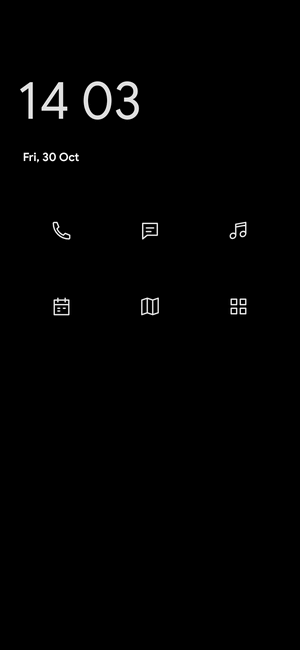
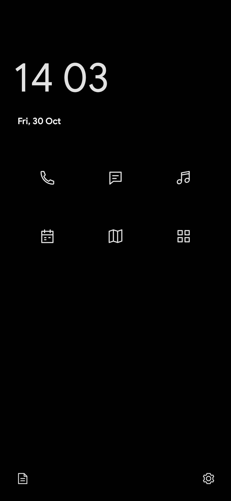

# nia

**A quieter way home.**

nia is a minimalist Android launcher built around five everyday shortcuts, a clock and date, and a searchable app list. Keep the apps you reach for close, with a little more space around everything else.

[Download nia](https://github.com/robin-siegl/Nia/releases/latest) · [Changelog](CHANGELOG.md) · [Privacy](docs/PRIVACY.md)

  
  
  

## Your essentials, in a familiar place

**Phone. Messages. Music. Calendar. Maps.** Assign each shortcut to the app you prefer. Choose an outline icon grid or a plain text list; the order stays the same.

The time opens Clock, and the date opens your Calendar. Two optional bottom corners give you quick access to other apps, with a choice of matching outline icons. Leave both empty for a simpler Home.

## All your apps, a swipe away

Swipe up or tap **Apps** to open an alphabetical list of app names. Search by name, initials or words in any order, or enable A–Z navigation to jump through the list.

You can have the keyboard open automatically when Apps is ready. When a search finds just one app, press Enter to open it. Touch and hold an app name for App info or to assign it to a corner.

  
  

## Colors that belong together

Keep it black and white, or choose one color and let nia create a matching light and dark theme. Follow your phone's theme or pick one yourself.

Monochrome dark mode uses **true `#000000` black**. Colored themes can use a pure black background too. A color wheel, presets and a hex field help you find a combination you like, with both themes shown in a live preview.

  

## A few thoughtful details

- Guided setup helps you choose your layout, apps and colors.
- Settings show your current choices, with readable controls and an adjustable Home text size.
- Save your settings to a file and review the changes before restoring a backup.
- Check for a new GitHub release from **About nia** whenever you choose.
- Choose reduced animations; both motion options follow Android's animation settings.

  
  

These previews are rendered from nia's native interface. System bars and Android's own transitions depend on your phone.

## Get nia

1. Download `nia-VERSION.apk` from the [latest release](https://github.com/robin-siegl/Nia/releases/latest).
2. Open the APK and follow Android's installation prompts.
3. Open nia, follow setup, and choose it as your default Home app.

To switch launchers later, open **Settings → Default launcher** in nia, or Android's **Default apps → Home app** settings. Open nia Settings from the gear in Apps, or touch and hold empty space on Home.

nia requires **Android 10 or later**. Development focuses on the **Pixel 10 Pro** and the normal personal profile. Work profiles and Private Space are not currently supported. Pixel-style clock positioning follows a reference layout; it does not automatically mirror your lock-screen customization. Exact Pixel weather integration is still deferred.

## Private by design

Home, search, settings and backups work offline. nia has no accounts, ads or analytics and does not upload your app list. Internet access is used only for the update check you start in About nia. [Read the privacy details](docs/PRIVACY.md).

## Development

nia is built with Kotlin and Jetpack Compose. Start with [Contributing](CONTRIBUTING.md) for local builds and checks, [Releasing](docs/RELEASING.md) to create a signed APK through GitHub Actions, or the [roadmap](docs/ROADMAP.md) for future work.

The [design guide](docs/DESIGN.md) describes nia's visual and interaction principles. The [architecture guide](docs/ARCHITECTURE.md) explains its state, data and Android integration. Coding-agent instructions and development skills start in [AGENTS.md](AGENTS.md).

A source license has not yet been specified. Dependencies and bundled fonts retain their own licenses; see [third-party notices](THIRD_PARTY_NOTICES.md).
