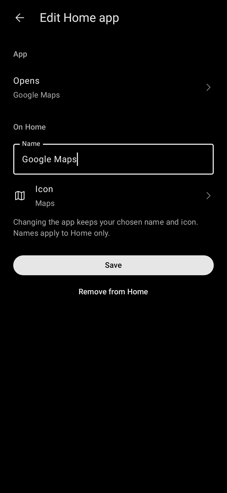
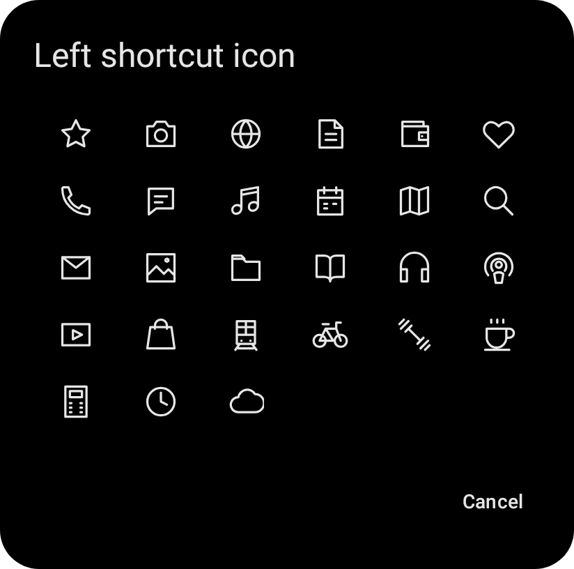
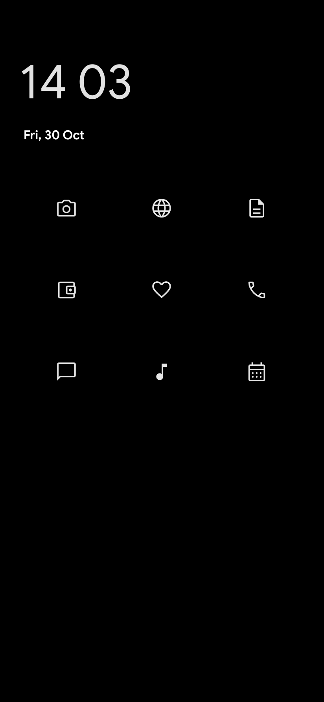
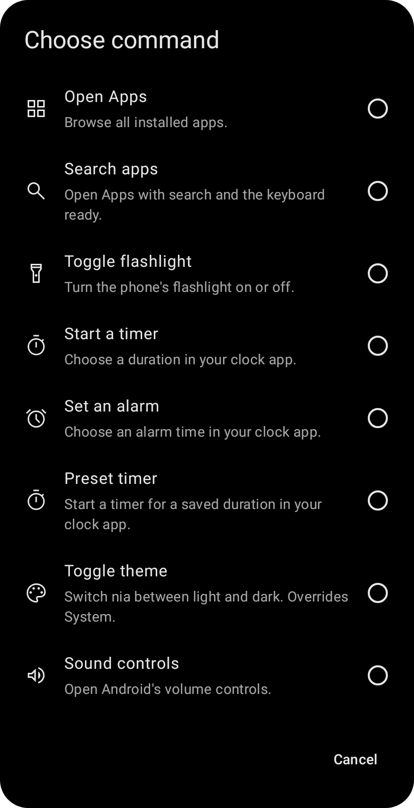
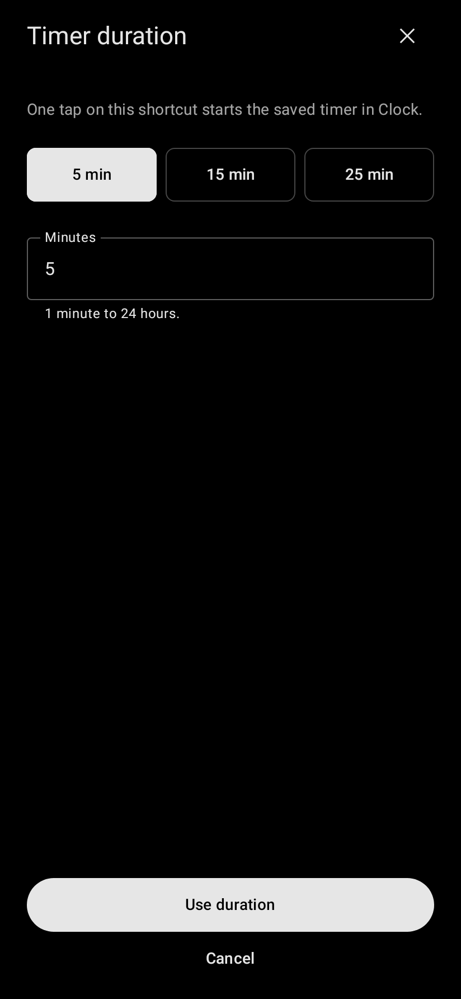
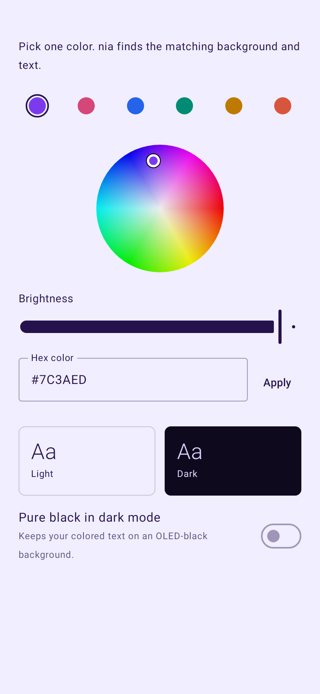
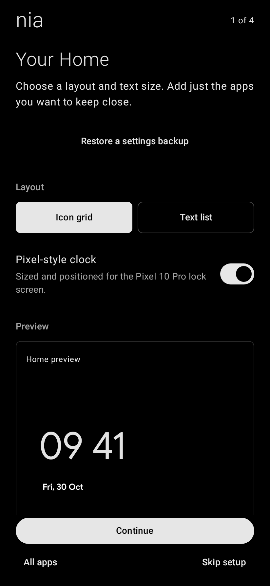
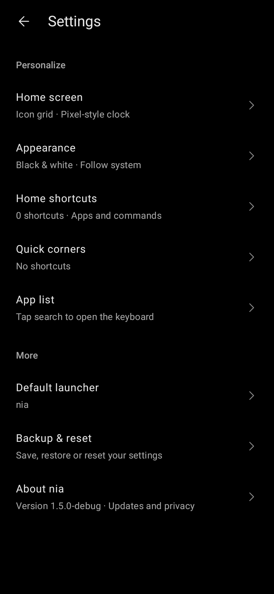

# nia

**A quieter way home.**

nia is a minimalist Android launcher with your chosen shortcuts, a clock and date, and a searchable app list. Keep the apps you reach for close, with a little more space around everything else.

[Download nia](https://github.com/robin-siegl/Nia/releases/latest) · [Changelog](CHANGELOG.md) · [Privacy](docs/PRIVACY.md)

  
  
  

## Your essentials, in a familiar place

Choose what belongs on your Home. Add up to **nine apps or commands**, pick their names and outline icons, and drag them into your own order. Use a three-column icon grid or a plain text list; both share your arrangement.

Start with an empty Home and add just what you need during setup, or later in **Settings → Home shortcuts**. Every entry can be edited or removed. Upgrading from an earlier nia keeps your existing shortcuts.

The time opens Clock, and the date opens your separately assigned Calendar. **Quick corners** put an optional app or command in each bottom corner. Leave either one empty for a simpler Home.

Choose from **193 Material Symbols** with searchable names, keywords and categories. Home shortcuts and Quick corners share the same picker: preview a choice, then confirm it.

  
  

## All your apps, a swipe away

Swipe up to open an alphabetical list of app names. The clock shrinks as your shortcuts move upward; long lists then scroll before handing off to Apps. A small chevron and one light haptic mark the deliberate pull. The icon grid stays on one screen. Search by name, initials or words in any order, or enable A–Z navigation to jump through the list.

You can have the keyboard open automatically when Apps is ready. Prefer a visible shortcut? Add **Open Apps** or **Search apps** wherever you want; neither is added automatically. When a search finds just one app, press Enter to open it. Touch and hold an app name to add it to Home, open App info or assign it to a Quick corner.

Commands can also toggle the flashlight or nia's light/dark theme, open Android's sound controls, or hand you to Clock to set an alarm or timer. **Preset timer** starts a saved duration in Clock: choose 5, 15 or 25 minutes, or enter your own. Every Home shortcut and Quick corner can have its own preset. The theme toggle selects Light or Dark; choose System in Appearance to follow your phone again.

  
  
  

## Colors that belong together

Keep it black and white, or choose one color and let nia create a matching light and dark theme. Follow your phone's theme or pick one yourself.

Monochrome dark mode uses **true `#000000` black**. Colored themes can use a pure black background too. A color wheel, presets and a hex field help you find a combination you like, with both themes shown in a live preview.

  

## A few thoughtful details

- Guided setup helps you choose your layout, shortcuts and colors—or skip adding shortcuts for an empty Home.
- Settings show your current choices, with readable controls and an adjustable Home text size.
- Save your settings to a file and review names, icons, order, app assignments and other changes before restoring a backup.
- Check for a new GitHub release from **About nia** whenever you choose.
- Choose reduced animations; both motion options follow Android's animation settings.

  
  

These previews are rendered from nia's native interface. System bars and Android's own transitions depend on your phone.

## Get nia

1. Download `nia-VERSION.apk` from the [latest release](https://github.com/robin-siegl/Nia/releases/latest).
2. Open the APK and follow Android's installation prompts.
3. Open nia, follow setup, and choose it as your default Home app.

To switch launchers later, open **Settings → Default launcher** in nia, or Android's **Default apps → Home app** settings. Open nia Settings from the gear in Apps, or touch and hold empty space on Home.

nia requires **Android 10 or later** and requests portrait orientation on phones. Development focuses on the **Pixel 10 Pro** and the normal personal profile. Work profiles and Private Space are not currently supported. Pixel-style clock positioning follows a reference layout; it does not automatically mirror your lock-screen customization. Exact Pixel weather integration is still deferred.

## Private by design

Home, search, settings and backups work offline. nia has no accounts, ads or analytics and does not upload your app list. Internet access is used only for the update check you start in About nia. [Read the privacy details](docs/PRIVACY.md).

## Development

nia is built with Kotlin and Jetpack Compose. Start with [Contributing](CONTRIBUTING.md) for local builds and checks, [Releasing](docs/RELEASING.md) to create a signed APK through GitHub Actions, or the [roadmap](docs/ROADMAP.md) for future work.

The [design guide](docs/DESIGN.md) describes nia's visual and interaction principles. The [architecture guide](docs/ARCHITECTURE.md) explains its state, data and Android integration. Coding-agent instructions and development skills start in [AGENTS.md](AGENTS.md).

A source license has not yet been specified. Dependencies, bundled fonts and Material Symbols retain their own licenses; see [third-party notices](THIRD_PARTY_NOTICES.md).
