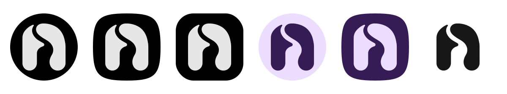

# nia brand kit

nia's mark is a lowercase **n** made from two flowing forms. It borrows the sense of balance from yin-yang while keeping the letter recognizable. Use the approved outline from the vector master for every export.



## Choose an asset

| Asset | Use |
| --- | --- |
| [Mark, dark](svg/nia-mark-dark.svg) · [light](svg/nia-mark-light.svg) | Symbol alone, on a light or dark surface |
| [Wordmark, dark](svg/nia-wordmark-dark.svg) · [light](svg/nia-wordmark-light.svg) | Lowercase nia lettering |
| [Horizontal logo, dark](svg/nia-lockup-dark.svg) · [light](svg/nia-lockup-light.svg) | Mark and wordmark together, including the README |
| [App icon SVG](svg/nia-app-icon.svg) | Soft white mark on pure black, without a baked-in device mask |
| [512px app icon](png/nia-app-icon-512.png) · [1024px](png/nia-app-icon-1024.png) | Square raster exports for listings and artwork |
| [PNG exports](png/) | Transparent 1024px marks, 1200px wordmarks and 1600px horizontal logos in both colors |
| [Icon previews](previews/icon-masks.svg) | Circle, squircle, rounded-square and tint examples; these are illustrations, not phone screenshots |

**Dark** means dark ink for a light surface; **light** means soft white for a dark surface. Transparent files include clear space. PNG dimensions describe width; horizontal logos and wordmarks retain their original proportions.

## Appearance

| Color | Value | Use |
| --- | --- | --- |
| Black | `#000000` | Default app-icon background and OLED artwork |
| Soft white | `#E6E6E6` | Mark and lettering on dark backgrounds |
| Dark ink | `#171717` | Mark and lettering on light backgrounds |

Keep the product name lowercase: **nia**. Use **nia Dev** only for the separate development installation. The tagline is **A quieter way home.**

Use the mark at 24px or larger. Keep the clear space supplied in the SVG viewBox: at least one eighth of the visible mark's height around it. Scale uniformly. Preserve the two components, rounded ends and separating curve as a single design; do not move the pieces independently, stretch the mark, add an outline or fill its gap. Use flat colors without shadows or gradients. Tinting the whole mark is appropriate for nia's own themes and Android's themed icons.

The wordmark is outlined artwork with no font dependency. In the app, keep the name as accessible, scalable text alongside the shared `NiaBrandMark` composable. About and setup use that treatment.

## Android resources

The app uses native vectors generated from the [mark master](source/nia-mark.svg). Foreground and background remain separate. Android owns the outer icon mask, so the foreground contains no circular border or shadow.

The foreground is a 108dp layer. Its two paths sit inside the central safe area, with a maximum 33dp radius from the center. One adaptive resource supplies foreground/background and the same foreground as a monochrome alpha layer for API 33+. Older Android versions ignore that optional layer. Both manifest icon attributes point to this adaptive resource. Production, Dev and Debug retain their existing application IDs and labels.

See [Android's adaptive icon guidance](https://developer.android.com/develop/ui/compose/system/icon_design_adaptive) and the [device checks](../docs/DEVICE_TESTING.md#branding-and-app-icons).

Native Android resource renders: [API 29](../docs/screenshots/app-icon-api-29.png), [API 35](../docs/screenshots/app-icon-api-35.png), [About in dark mode](../docs/screenshots/about-nia.png) and [About with large text](../docs/screenshots/about-nia-light-large.png). These are automated native renders, not physical Pixel screenshots.

## Edit and regenerate

The two editable masters are [nia-mark.svg](source/nia-mark.svg) and [nia-wordmark.svg](source/nia-wordmark.svg). The mark preserves the approved refined concept as two filled paths. Edit these masters for geometry rather than individual exports or Android paths. The generator owns the fixed export palette and Android placement. Android paths use compact coordinate precision; SVG masters retain their full precision.

Regeneration needs Python, a local Cairo runtime and the optional export dependency:

```sh
python3 -m pip install -r scripts/branding-requirements.txt
python3 scripts/sync_branding.py
python3 scripts/sync_branding.py --check
```

Run these commands from the repository root. The script writes SVG/PNG exports, Android vectors, adaptive icon resources and a checksum manifest. Commit the generated files together. Normal app builds never run the renderer or require Cairo.

`--check` uses only Python's standard library and works offline. CI checks that the Android and SVG exports still match the masters and that all committed PNG checksums match the manifest. After changing geometry, inspect the native icon and About/setup renders, check the mask/tint previews and repeat the physical-device icon checks.
