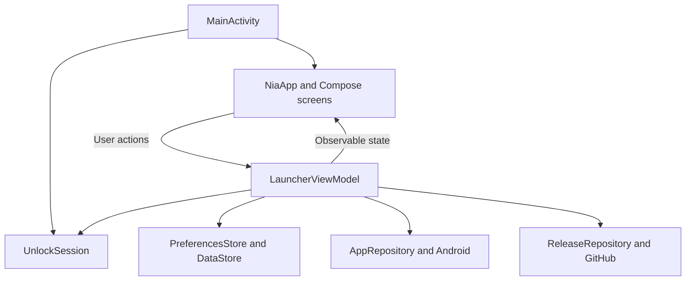

# Architecture guide

nia is a single-activity Kotlin/Jetpack Compose app with a small custom navigation stack, DataStore-backed preferences and Android launcher integration. Keep responsibilities visible and changes proportional to the app. This guide describes the implemented structure; file contents remain authoritative for exact values and behavior.

## Contents

- [Code map and data flow](#code-map-and-data-flow)
- [State lifetimes](#state-lifetimes)
- [Discovery, launching and navigation](#discovery-launching-and-navigation)
- [Preferences and backups](#preferences-and-backups)
- [Unlock and input reliability](#unlock-and-input-reliability)
- [Network and platform boundaries](#network-and-platform-boundaries)
- [Validation and maintenance](#validation-and-maintenance)

## Code map and data flow

All paths below are relative to [app/src/main/java/dev/robinsiegl/nia](../app/src/main/java/dev/robinsiegl/nia).

| Area | Responsibility |
| --- | --- |
| `MainActivity.kt` | Activity/window callbacks, Home intents, screen broadcasts and system bars |
| `LauncherViewModel.kt` | Exposed state, navigation, user actions, launch guards and restore/update coordination |
| `ui/` | Compose screens, interaction and presentation state, themes applied through `NiaTheme` |
| `model/` | Preferences, app identities/search, navigation, restore/release models, header geometry and unlock state |
| `data/` | Preferences DataStore and strict backup serialization/migration |
| `platform/` | Android app discovery/launching, flashlight access and the manual GitHub release request |
| `theme/` | Seed-color conversion, paired palette generation and contrast checks |

`NiaApp` collects flows with `collectAsStateWithLifecycle`, connects screen callbacks and owns activity-result launchers for file selection and the Home chooser. `LauncherViewModel` currently extends `AndroidViewModel` and creates its dependencies from the application context. Keep Activity/View references out of it. Prefer explicit dependency injection when changing these boundaries, without introducing a framework or extra layers for a small isolated change.

Most model logic is independent of Android. `UnlockSession` deliberately uses Compose observable state so the retained session can drive effects. UI functions receive values and callbacks; persistence, package queries and networking stay outside screen composables. Blocking work uses I/O dispatchers, and cancellation is propagated.

## State lifetimes

| State | Owner and lifetime |
| --- | --- |
| Preferences and setup progress | `PreferencesStore`; survive process death, reboot and normal signed upgrades |
| Available apps, navigation, restore preview, update result and launch guards | ViewModel; retained through activity recreation, not a persistent process-death record |
| Observed lock and pending reveal | ViewModel-owned `UnlockSession`; retained through activity recreation |
| Drawer progress, list scroll, search and local dialogs | Compose state/effects; transient or locally saveable as implemented |
| Snackbar feedback | ViewModel message channel consumed by the UI; transient feedback, not durable state |

Keep one owner for each value. Do not persist temporary focus, searches, motion progress or update responses in settings. A ViewModel does not survive process death; rebuild platform observations and reload persisted settings on a new process.

## Discovery, launching and navigation

[AppRepository.kt](../app/src/main/java/dev/robinsiegl/nia/platform/AppRepository.kt) uses `LauncherApps` for the current `Process.myUserHandle()`. It intersects returned entries with declared MAIN/LAUNCHER activities to exclude synthetic App-info entries for background-only packages. Distinct launch activities and aliases retain distinct component identities.

`AppTarget` stores package and activity names. Labels are presentation, not identity. `LauncherApps.Callback` refreshes the list for relevant package changes; its callback is unregistered through `awaitClose`. Keep package enumeration off the main thread. The manifest declares scoped launcher/clock intent visibility.

Launch and App-info actions use `LauncherApps`. An unassigned or unavailable Home entry opens its editor for reassignment. A shared 450ms `LaunchGate` rejects rapid duplicate launches and resets after a failed launch. App assignments do not change Android's default dialer, messaging or navigation apps.

The manifest exposes HOME/DEFAULT and LAUNCHER entry points and uses `singleTask`. The system Home chooser uses `RoleManager.ROLE_HOME`, with a Home-settings fallback. Default-launcher status refreshes on resume.

The activity requests `screenOrientation="portrait"`, covering all nia screens on the primary phone. Keep the compact-layout fallback for Android-controlled windows: the platform can override orientation restrictions in multi-window and on large screens. Do not add sensor listeners or recreate the activity manually to fight those policies. See [activity orientation](https://developer.android.com/guide/topics/manifest/activity-element#screen) and [Android 16 large-screen behavior](https://developer.android.com/about/versions/16/behavior-changes-16#adaptive-layouts).

`Navigation` is an immutable stack of `Screen` values. Keep its simple Back behavior. `onNewIntent` handles a new HOME intent synchronously, returns navigation Home and signals transient drawer/keyboard reset. `HomeAppsScreen` keeps Home composed beneath Apps so the header and drawer share continuous state. Use this path for both taps and gestures.

## Preferences and backups

[PreferencesStore.kt](../app/src/main/java/dev/robinsiegl/nia/data/PreferencesStore.kt) keeps serialized `SavedState` under the `state.v1` key in Preferences DataStore. Update it transactionally, validate the next preferences before saving, and avoid overwriting unreadable state with defaults. The recovery UI keeps restore and full reset available.

[BackupCodec.kt](../app/src/main/java/dev/robinsiegl/nia/data/BackupCodec.kt) exports UTF-8 JSON with format `nia.settings`, a schema version, personal-profile scope, timestamp and preferences. The current export schema is **8**, with imports for **1–8** and a **256KiB** limit. Setup progress, searches, usage history and the full installed-app inventory are excluded. Android automatic app-data backup/transfer is disabled in favor of explicit settings files.

Keep decoding strict. Validate schema, colors, enums and component identities before writing; reject unsupported profiles and arbitrary intent data. Legacy Settings corners migrate to Empty, and legacy gear icons to Star. Preserve other valid preferences through migration.

`RestorePreview` computes each changed before/after value and sanitizes unavailable assignments. Before applying, the ViewModel re-reads current preferences and available apps. If the result changed, show the revised preview for review. Keep duplicate submission guards and apply the reviewed state together. Cancel or a failed import must leave existing settings intact.

Reset appearance/behavior restores default preferences while retaining Home entries/order/names/icons, Clock, Calendar and both corner configurations. Full reset clears the saved state and returns to setup. Both UI actions require confirmation.

### User-defined Home

`LauncherPreferences.homeShortcuts` is an ordered list of zero to nine `HomeShortcut` entries. Each entry has a stable ID, user label and outline icon, and targets an app or a typed `ShortcutCommand`. Home, previews, onboarding and the editor use this list; there is no generated Apps entry. `HomeCategory` remains only for migration and legacy glyph mapping, never for resolving active Home content.

`BackupCodec` converts legacy schema-1–5 backups and old stored preferences to five ordinary editable entries, preserving even unassigned categories. It seeds the independent Calendar target from the legacy Calendar assignment and preserves Clock. An absent list in old stored state triggers migration; an explicitly empty current list stays empty. A missing DataStore record uses the new empty-install defaults.

The ViewModel owns `HomeShortcutDraft` through app/icon picking and activity recreation. Drafts and navigation are transient and do not survive process death; saved entries and setup progress do. Cancel discards the draft; Save validates and commits the whole entry transactionally. Reassigning preserves a chosen name/icon. Reordering changes the same list for both layouts. Custom names apply only to Home, not alphabetical search.

`ShortcutIcon` has stable serialized IDs; labels, categories and search keywords are presentation metadata. `IconCatalog` provides pure, alphabetical filtering. Home and Quick corners use the same `ShortcutIconPicker`, which owns a saveable pending selection/query/category and only calls its persistence callback on confirmation. The picker owns its dialog window, safe/IME insets and system-bar contrast; it keeps no Activity reference. Read focus, keyboard and density from inside that dialog. Opening clears the underlying editor's text focus; selecting an icon clears dialog search focus while preserving keyboard focus on a tile.

The catalog and Android resource mapping are generated from `scripts/material_symbols.json`. `scripts/sync_material_symbols.py --download` deliberately imports a pinned Google Material Symbols subset; `--check` validates it offline, including its Apache 2.0 license. Gradle and the running launcher never download icons. Vector paths are unchanged; Compose applies the palette instead of Android theme tint. Keep the 27 original IDs and legacy Settings-to-Star migration. The new generic gear uses `GEAR`, so it cannot collide with the removed `SETTINGS` icon/action. Quick corners retain the `leftShortcut`/`rightShortcut` keys. Schema 7 adds an optional typed command target to Home and corner entries. Schema 8 adds per-entry `timerMinutes` for preset timers only, requiring 1–1,440 whole minutes. Clear it when assigning an app or another command. Reject preset parameters disguised as schemas 1–7, and show duration-only changes in restore previews.

Restore previews compare additions/removals, names, icons, app targets, order and independent Clock/Calendar targets. An unavailable app clears its target while retaining the Home entry's identity, presentation and position. Applying still revalidates the reviewed result.

### Shared Home gesture coordination

`HomeHeaderScroll` consumes the header's height change before content scrolls. `MorphingClockHeader` draws and transforms the same clock/date paths, with moving touch targets and no crossfade. Changing header height physically moves the content below it. The grid keeps its cell sizes while moving upward; the list uses one scroll viewport for all configured entries.

`AppsPull` owns direct finger distance and arming with hysteresis. `DrawerMotion` owns drag/settle progress and cancellation leases. An upward drag first collapses the header, then scrolls a long list, then passes remaining **UserInput** distance to the Apps pull. Fling/side-effect scrolling cannot arm Apps. The arming threshold is 112dp; reversal below 72% disarms. Emit one threshold cue per gesture through `View.performHapticFeedback`, respecting the system setting without a vibration permission. Pointer termination distinguishes up from cancel.

Home remains composed beneath Apps. Preserve scroll/header state on ordinary drawer dismissal, but key fresh state to explicit Home and unlock requests before the visible reveal. Keep completion and scrollability reads subscribed in composition. Search autofocus waits until the drawer settles; the Search apps command overrides the saved autofocus preference only for that opening.

Keep the empty-space long-press pointer handler attached with stable keys and check its current enabled state inside the handler. Removing or rekeying it when a pull begins cancels descendant list gestures. The parent drag fallback also handles swipes that start in a header or empty space beneath a short list.

`ShortcutReorderState` owns transient drag order, item bounds and the grabbed point for both Home and Settings. Stable item keys keep gestures attached while entries move across rows. Edge scrolling moves only the list, never opens Apps. Preview locally and invoke one validated order write on drop; cancel writes nothing. A changed entry set cancels the drag, and the ViewModel rejects stale IDs transactionally. Keep the write in the ViewModel scope so recreation does not interrupt an accepted drop.

Measure each reorder slot outside its lifted/translated content. Publish the pointer and proposed order in one snapshot, then place the lifted item relative to its untransformed slot. Verify that its visible bounds follow the finger, as well as checking the saved order.

Commands are an enum allowlist, not serialized intents. The ViewModel dispatches local list/theme actions, flashlight control, Clock actions and sound controls. `FlashlightController` uses the application context and public `CameraManager` torch API, chooses a flash-capable camera, observes actual torch changes (including Quick Settings), handles unavailable resources and unregisters callbacks on cleanup. Camera enumeration and torch calls stay off the main thread; no camera session or CAMERA permission is needed. See [CameraManager](https://developer.android.com/reference/android/hardware/camera2/CameraManager#setTorchMode(java.lang.String,%20boolean)).

`AppRepository.startTimer(minutes)` sends `AlarmClock.ACTION_SET_TIMER` with `EXTRA_SKIP_UI=false`. A null duration opens setup; a validated preset converts whole minutes to seconds (at most 86,400) and starts the timer in Clock. `setAlarm()` sends `ACTION_SET_ALARM` without a time so Clock shows its editor. Android selects a compatible handler, independently of nia's header Clock assignment. Clock owns timer execution, alerts and cancellation; setup commands also leave duration or alarm-time entry there. Declare the normal `com.android.alarm.permission.SET_ALARM` permission; do not add exact-alarm access, a timer service, notification access or an extra runtime prompt. Start the activity directly and handle an unavailable/disabled handler, without querying installed timer apps. External timer launches share the launch gate and reset it on failure so retry works immediately. See [AlarmClock](https://developer.android.com/reference/android/provider/AlarmClock#ACTION_SET_TIMER).

Sound controls starts `Settings.Panel.ACTION_VOLUME`, falling back to `ACTION_SOUND_SETTINGS` only if the panel has no handler. Android owns the controls, with no direct audio-setting writes or policy permissions. Toggle theme updates DataStore transactionally: System switches to the opposite of the current configuration's night mode, while explicit Light/Dark invert each other. It changes nia only, preserving the seed and pure-black preference; Appearance can select System again. Theme and flashlight actions do not use the external-activity launch gate.

## Unlock and input reliability

Treat **keyguard state, interactivity, lifecycle and window focus as separate observations**. `MainActivity` supplies an `UnlockEnvironment`; `UnlockTracker` recognizes a candidate unlock, while `UnlockSession` owns the queued request and active/locked UI state.

A reveal runs only in a resumed, focused, interactive and unlocked Home window. It remains pending until Home's animation completes. Focus loss or an interrupted foreground pause replaces unfinished work with a new request identity, so a canceled effect cannot consume its replacement. Keep this state in the ViewModel across activity recreation.

The tracker preserves an observed lock through a late stop callback. A candidate has a 1.5-second background grace period after user-present; resuming within it pins the candidate while focus arrives. An explicit user departure discards queued work, and an unlocked stop cancels an already-created reveal. Ordinary returns from another app must not replay it.

Screen broadcasts can be deferred. Check current power/keyguard state before treating SCREEN_OFF as a new lock. Do not assume USER_PRESENT, resume and focus arrive in one order. A lit ambient display is not proof of interactivity. A cold process first created after unlocking may not have observed that unlock.

`UnlockRevealRequest.pending` is a plain Boolean. The observable request identity and session state drive effects; do not introduce new UI gates that depend on that Boolean changing without an observable update.

### Keep input completion observable

In `HomeScreen`, read reveal completion and scrollability in composition even while input is disabled. Capture the results, then report them through `SideEffect`. A read only inside `SideEffect`, or behind a short-circuiting `interactionEnabled && ...` condition, can miss the update and leave an invisible parent touch blocker active after the animation ends.

The same principle applies to `scroll.maxValue`: keep the composition subscribed before notifying the drawer about Home scrollability. Preserve cancellation cleanup in drawer motion, zero-duration behavior and search focus after settling. A minute tick, unrelated recomposition or recovery timer must not be required to restore input.

A tap-to-wake versus power-button-wake difference remains a physical Pixel validation item. The system may reveal nia after its own window becomes active. The short animation lead-in in the [design guide](DESIGN.md#motion-and-input) does not establish when SystemUI is visually finished. Investigate actual sequences before changing signals or adding delays.

## Network and platform boundaries

### Manual updates

`ReleaseRepository` makes the only in-app network request, initiated by **About nia → Check for updates**. It uses unauthenticated HTTPS to the fixed GitHub latest-release endpoint, 8-second connect/read timeouts, a 1MiB response limit and no redirects. `AppRelease` validates stable versions and nia's exact GitHub release/APK URLs. Results stay in memory; links open externally. Keep checks, downloads and installation user-initiated. See [Privacy](PRIVACY.md).

### Platform boundaries

Keep the current personal-profile scope. Work-profile support would need profile identity and availability throughout discovery, assignments, launching and backups. Private Space additionally needs Android's full locked/hidden-container and search-exclusion behavior. Adding a permission or listing extra profiles alone does not implement that contract.

Ordinary Home selection and launching do not need an accessibility service, overlay, device administrator, root or battery exemption. The manifest's Internet permission serves the manual update check. Pixel SystemUI transition control and direct keyguard-state subscription use restricted platform permissions, not an ordinary permission prompt a third-party launcher can enable.

The Pixel clock/weather component is not a supported public launcher widget: `SmartspaceManager` is a system API, and the clock's weather flow lives in SystemUI. Exact weather remains deferred until supported data and correctly licensed icons can meet the intended appearance. Do not add fabricated weather or private API workarounds.

## Validation and maintenance

Follow [CONTRIBUTING.md](../CONTRIBUTING.md) for commands and [DEVICE_TESTING.md](DEVICE_TESTING.md) for device checks. Use pure model tests for search, validation and state rules, and native Compose interaction tests for UI behavior. Keep fixed-clock pointer regressions for Home input recovery and inject motion duration scale into Compose's test effect context when exercising animation settings.

The standard CI jobs are Unit and UI tests, Android lint and Debug APK. Production adds version validation, a minified signed release, signature verification and optional publication. `gradle.properties` owns the version; see [Releasing](RELEASING.md#version-policy). Preserve application IDs, signing identity, migrations and license assets unless a change explicitly requires otherwise.

### Primary references

- [Android architecture recommendations](https://developer.android.com/topic/architecture/recommendations), [state hoisting](https://developer.android.com/develop/ui/compose/state-hoisting) and [side effects](https://developer.android.com/develop/ui/compose/side-effects)
- [LauncherApps](https://developer.android.com/reference/android/content/pm/LauncherApps), [package visibility](https://developer.android.com/training/package-visibility/declaring) and [Home role](https://developer.android.com/reference/android/app/role/RoleManager#ROLE_HOME)
- [Activity focus/lifecycle](https://developer.android.com/reference/android/app/Activity#onWindowFocusChanged(boolean)), [broadcast delivery](https://developer.android.com/develop/background-work/background-tasks/broadcasts) and [PowerManager](https://developer.android.com/reference/android/os/PowerManager)
- [Private Space requirements](https://developer.android.com/about/versions/15/behavior-changes-all#private-space)
- [Platform permissions](https://android.googlesource.com/platform/frameworks/base/+/refs/heads/main/core/res/AndroidManifest.xml) and [SmartspaceManager](https://android.googlesource.com/platform/frameworks/base/+/refs/heads/main/core/java/android/app/smartspace/SmartspaceManager.java)
